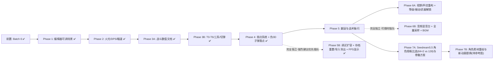

# 《蓟花行动 / Operation Thistle》下一阶段更新总计划与执行提示词

> [!NOTE]
> 本文档已接入仓库版本控制（前置 Batch 1–6 于 `edc0772` 完成并打远端备份标签 `backup/pre-phase1-editor-config`；**Phase 1–4、启动异步预热优化与 Phase 5B 已全部落地，59 项核心测试全绿 / 1835 断言 0 失败**）。
> **推进原则**：每次只推进**一个阶段**，做到「单阶段实现 → 全量回归测试 → 实机截图/听感验收 → 本地原子提交（不自动 push）」。

---

## 一、全局排期总览与依赖关系

| 阶段 | 核心主题 | 交付形式 | 状态 / 建议位置 |
| :--- | :--- | :--- | :--- |
| **前置（Batch 6）** | 图形化弹药容器 HUD + `ammo_display` 三模式 + 实验性真实逐发 | 代码 + 测试 + 对比截图 | **已完成（`dd05e93` / `edc0772`）** |
| **Phase 1** | Godot 编辑器独立可调固定场景 & `.tres` 配置资源化 | 场景/资源 + 速查表 | **已完成（`e153b98`）** |
| **Phase 2** | 火光三档设置 + 武备库真实 DPS + 18 枪差异化瞄速 + 狙击镜渐变 | 代码 + 测试 + 截图 | **已完成（`81090b0` / `e92e60c`）** |
| **Phase 3A** | 《弹药 T0–T6 穿甲分级 × 敌人三系生态 × 武器固有加成》数值总表 | 设计文档 | **已完成（`670a2ef`）** |
| **Phase 3B** | T0–T6 弹药/三系敌人/武器加成/`Q` 键切弹落地 + 3B 微调（差分耗弹暂关、RHA 区间上调） | 数据/代码 + 测试 + 截图 | **已完成（`21be2b8` / `3c25e3f`）** |
| **Phase 4** | 可配置部位弱点系统（Weakspot）+ 轻量伪 3D 子弹落点修正 | 代码 + 测试 + 截图 | **已完成（`a673c8e` + 启动预热优化 `da65eee`）** |
| **Phase 5B（提前插队完成）** | 调试模式三页分页扩容（战斗视野/生存恢复/资源等级）+ 存档重置/清空与 `.json` 导出/导入 + 设置可开关全局 FPS 帧率显示 | UI/存档代码 + 测试 + 截图 | **已完成（59/59 PASS，1835 断言）** |
| **Phase 5** | 翻滚与战术躲闪系统（逻辑、防穿墙、短无敌帧、占位残影先行） | 代码 + 测试 + 截图/录屏 | 与角色美术解耦，提前验收手感 |
| **Phase 6A** | 天赋视野距离/角度升级 + 声纹 Lv.5 涟漪共存 + 等级曲线重构 + 可开关角色被动 + 武器等级解锁 | 数据/系统/UI + 测试 + 截图 | 成长与感知系统收口（依赖存档与调试基建） |
| **Phase 6B（原 Phase 6）** | 音频混音总线（`default_bus_layout.tres`）+ 全量采样管线 + 蒸汽波/Darksynth BGM | 音频架构 + 合法素材/兜底 + 替换指南 | **完全独立**，可随时插队 |
| **Phase 7A** | Seedream 5.5 角色像素规格验证（`64px×2` vs `128px` 同屏二选一锁死）与模块化骨骼定型 | **方案文档 + 实机同屏验证样稿** | 防止“剪纸木偶感”与双规格 Mixels 返工 |
| **Phase 7B** | 依据用户参考图用 Seedream 5.5 生成母版并下采样重绘主角、4 类持枪/瞄准姿态与翻滚正式动画 | 美术资源 + 骨架代码 + 验收 | 压轴专项（待提供角色参考图后启动） |

---

## 二、全阶段通用工程约束

- **本地原子提交，绝不自动 `git push`**；绝不暂存或回退工作区既有未关联文件（`addons/godot_ai/*`、`export_presets.cfg`）。
- **测试门禁**：每阶段代码落地后必须跑通全量核心回归测试脚本 `run_core_tests.ps1`（`Fail=0, ScriptErrors=0`）。
- **外部媒体与存档隔离**：实机验证截图统一输出到 `D:\AI Game\HellWalker\captures\screenshots\`；独立验证脚本必须携带 `-- --save-path user://verify_xxx.json` 隔离玩家真实存档。

---

## 三、分阶段详细内容与执行提示词

### Phase 1：Godot 编辑器独立可调固定场景 & 配置资源化

- **核心目标**：排查 `scenes/core/Main2D.tscn`、`scenes/actors/Doll2D.tscn`、`scenes/ui/StartMenu2D.tscn`，彻底解决“编辑器里改了属性、启动被脚本硬编码盖掉”的问题，同时严格守住「程序化动态值与存档/天赋不固化」边界。
- **验收标准**：在编辑器修改镜头默认缩放/光照/手感 `.tres` 后运行即刻生效；全量核心测试全绿；交付完整「配置修改速查表」（`docs/editor_config_reference.md`）。

---

### Phase 2：火光三档设置 + 武备库 DPS + 真正差异化瞄准速度

- **核心目标**：
  1. 将枪口火光移入设置菜单分三档（`full` 初版强闪屏 / `partial` 当前克制版 / `off` 关闭，含 `WeaponRig2D._flash` 联动）；
  2. 武备库新增真实 **爆发 DPS**（泵动/栓动计入完整循环周期）与悬浮 **持续 DPS / 单匣总伤**；
  3. 补齐 18 把武器差异化基础 `ads_time`（秒），并修复 `Main2D._ads_t` 漏乘高倍镜 `sight_ads_time_mul` 的同步 Bug。
- **验收标准**：设置页可切换火光三档并实机对比截图；武备库展示 DPS 与开镜秒数（手枪明显快于 AWM）；全量回归测试全绿。

---

### Phase 3：战斗数值体系重构（3A 文档审定 → 3B 代码落地）

- **Phase 3A（仅出文档 `docs/combat_balance_v2.md`）**：
  1. T1–T6 穿甲分级与肉伤/穿甲跷跷板模型（衔接 0.1 mm RHA）+ 局内 `Q` 键切弹方案；
  2. 敌人三系 `archetype`（`mech` / `human` / `mutant` + 单单位例外覆写）与 TTK 对比表；
  3. 18 把武器固有属性加成字段（`damage_mul` / `ap_mul` / `weakspot_mul` 等）。
- **Phase 3B（按审定文档落盘代码与 JSON）**：更新 `data/ammo.json`、`data/enemies.json`、`data/weapons.json`、`DamageModel`、`WeaponStatsModel`、武备库与 HUD 弹种/穿甲等级显示。

---

### Phase 4：可配置部位弱点系统 + 轻量伪 3D 子弹落点修正

- **核心目标**：
  1. 可配置 `weakspot` 部位弱点区（不写死头部，判定框 +15%~20% 宽容，射线优先弱点结算，专属金红飘字与破甲提示音）；
  2. 轻量伪 3D 高度弹道 `z`：瞄敌平射且绝不硬截断预判提前量；瞄近中距空地自然落地扬尘。

---

### Phase 5：翻滚与战术躲闪系统（逻辑与占位表现先行）

- **核心目标**：新增 `dodge`（`Space`）、位移曲线 + 短无敌帧 + 冷却与 HUD 指示、严格 `move_and_slide()` 防穿墙 + 临时忽略敌人碰撞防围死卡角，预留 Phase 7 正式动画挂口（当前先以残影 + 扬尘 + 占位音效验收手感）。

---

### Phase 5B：调试模式扩容 + 存档重置与导出/导入（完全独立，建议优先插队）

- **核心目标**：
  1. **调试模式分页重构（`DebugMenu2D`）**：拆分为「战斗与视野」「生存与恢复」「资源与等级」三页，避免单页溢出；
     - 生存与恢复：新增 `生命上限倍率`、`护甲上限倍率`（实时同步上限并缩放/钳制当前值）、`生命自动恢复（点/秒，绝对值而非倍率）`、`护甲自动恢复（点/秒，绝对值）` 及一键满血满甲；
     - 资源与等级：信用点、3 基础材料、4 进阶材料、经验/等级快捷增减与设值，附带「将直接写入当前存档」醒目提示；
  2. **存档重置与导出/导入（`SaveStore` / `SaveSlotsMenu2D`）**：
     - 存档重置：支持「重置当前游戏进度（默认保留画面/音量/键位设置）」与「清空指定槽位」，均需二次确认并先滚入 `.bak` 备份；
     - 导出/导入：支持原生文件弹窗导出/导入 `.json`（带版本标记与结构校验），导入前强制经过 `is_valid_save()` + `migrate_save_version()` + `normalize_data()` 校验，失败绝不覆盖现存档，且可选是否覆盖本地偏好设置。

---

### Phase 6A：视野/声纹天赋重构 + 等级系统、可开关被动与武器解锁

- **核心目标**：
  1. **视野距离与角度双天赋（`VisionFog2D` / `TalentTree2D`）**：
     - 解耦 `VisionFog2D` 的距离倍率与张角参数（避免 Y 轴拉伸导致高倍镜 + 角度天赋边缘畸变，总半角封顶 ≤ 82°/164° 保留背后盲区张力）；
     - 视野距离天赋除延展主锥外，同步扩大**近身黑暗感知半径 `DARK_RADIUS_METERS`**（避免 40m 主锥在 100% 缩放下早已超屏导致升级“无体感”）；
  2. **声纹共存与 Lv.5 解锁调整（`HearingIndicator2D`）**：
     - Lv.1–4 保留基础脚下声纹方位环并逐级提升听声距离（+10%/级）；
     - **Lv.5 满级解锁声波涟漪（屏内扩散波纹 + 屏外边缘来波前锋）并与基础方位环共存**（共存时自动略压低脚下环透明度防画面杂乱，并可在设置中按需切换显示偏好）；
  3. **等级系统重构（`MetaProgress` / `data/progression.json`）**：
     - 收口 `MetaProgress` / `SaveStore` / `TalentStore` 中 4 处硬编码 `1 + xp / 20`，改为 `data/progression.json` 驱动的非线性经验曲线与等级上限（建议上限 `Lv.50`）；
  4. **可开关角色被动天赋系统**：
     - 首批落地 2 个全局被动（存档记录独立开关 `passives_enabled`，支持逐项随时关闭以便纯基础手感测试或挑战局）：
       - **机体适应**：Lv.2 起每升 1 级 `+1%` 基础生命上限（按 `(level - 1) × 1%` 计算，保证 Lv.1 基线仍为 100 HP，与生命强化天赋采用加算防指数膨胀）；
       - **行动津贴**：Lv.2 起每升 1 级 `+1%` 局内撤离/浪潮结算信用点与基础材料收益（不作用于 XP 本身，避免经验滚雪球）；
  5. **等级驱动武器解锁（`weapons.json` / `ArmoryMenu2D`）**：
     - 为 18 把武器补充 `unlock_level`（初始 `G17` / `M870` 保持 `Lv.1`），兼容旧存档已装备武器不卡死，并在调试模式提供「全武器临时解锁」开关方便实机测试。

---

### Phase 6B（原 Phase 6）：音频全面重制（混音总线 + 全量采样管线 + 蒸汽波/暗黑合成器波 BGM）

- **核心目标**：
  1. 建立 `default_bus_layout.tres`（`Master`+Limiter ← `Music` / `SFX` ← `Weapons` / `Impacts` / `UI` / `Ambience`）；
  2. 全量外部采样热插拔管线（合法 CC0/免版税优先 + 润色版 `SfxSynth` 自动兜底 + LUFS 批处理脚本 + `assets/audio/CREDITS.md`）；
  3. 状态化双轨 Crossfade BGM 播放器（主菜单 Vaporwave + 探索 Dark Synth Ambient + 战斗/浪潮合法 Outrun/Darksynth）。

---

### Phase 7：角色像素重绘与模块化骨骼/动作重构（Seedream 5.5，7A 规格验证 → 7B 资产落地）

- **Phase 7A（方案与同屏验证样稿，待提供角色参考图）**：
  - 明确使用 **Seedream 5.5 图生图/参考一致性生成高清四视图与分件母版 → 脚本网格下采样 + 色板量化 + 轮廓清理**（严禁直接让文生图吐整张 64 帧序列图导致闪烁与比例漂移）；
  - 在真实 `Main2D` 中将 **`64px×2`（真复古像素放大）** 与 **`128px`（高精像素，与现有 128px 敌人/武器无缝匹配）** 同屏实机截图对比，**二选一锁死单一像素规格**（不同时维护双规格，防止 Mixels 割裂与双倍工作量），同时定型 4 大标准持枪/瞄准模板。
- **Phase 7B**：按审定参考图与锁定规格重绘主角及分件，实装 4 向待机/走/跑/受击/翻滚正式动画与 4 大持枪/瞄准过渡姿态。
