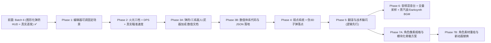

# 《蓟花行动 / Operation Thistle》下一阶段更新总计划与执行提示词

> [!NOTE]
> 本文档已接入仓库版本控制（前置 Batch 1–6 及实验性「真实逐发弹匣」已于 `edc0772` 完成并打远端备份标签 `backup/pre-phase1-editor-config`，56 项核心测试全绿）。
> **推进原则**：每次只推进**一个阶段**，做到「单阶段实现 → 全量回归测试 → 实机截图/听感验收 → 本地原子提交（不自动 push）」。

---

## 一、全局排期总览与依赖关系

| 阶段 | 核心主题 | 交付形式 | 状态 / 建议位置 |
| :--- | :--- | :--- | :--- |
| **前置（Batch 6）** | 图形化弹药容器 HUD（6 种动态弹匣/弹鼓轮廓 + `ammo_display` 三模式 + 实验性真实逐发） | 代码 + 测试 + 对比截图 | **已完成（`dd05e93` / `edc0772`）** |
| **Phase 1** | Godot 编辑器独立可调固定场景 & `.tres` 配置资源化 | 场景/资源改造 + 修改速查表 | **当前推进中**（`docs/editor_config_reference.md`） |
| **Phase 2** | 火光三档设置 + 武备库 DPS + 真正差异化瞄准速度（修复 `_ads_t` 同步） | 代码 + 测试 + 截图 | 轻量高收益，紧跟 Phase 1 |
| **Phase 3A** | 《弹药 T1–T6 穿甲分级 × 敌人三系生态 × 武器固有加成》数值总表 | **仅输出文档供评审** | 数值重构前必须先定数 |
| **Phase 3B** | 按定稿文档落地弹药、敌人三系、武器加成与局内切弹逻辑 | 数据/代码 + 测试 + 截图 | 紧跟 Phase 3A 审定后 |
| **Phase 4** | 可配置部位弱点系统（Weakspot）+ 轻量伪 3D 子弹落点修正 | 代码 + 测试 + 截图 | 依赖 Phase 3B 的三系敌人与穿甲模型 |
| **Phase 5** | 翻滚与战术躲闪系统（逻辑、防穿墙、短无敌帧、占位残影先行） | 代码 + 测试 + 截图/录屏 | 与角色美术解耦，提前验收手感 |
| **Phase 6** | 音频混音总线（`default_bus_layout.tres`）+ 全量采样管线 + 蒸汽波/Darksynth BGM | 音频架构 + 合法素材/兜底 + 替换指南 | **完全独立**，可随时插队提前做 |
| **Phase 7A** | 角色像素规格（64px×2 vs 96/128px）与模块化骨骼架构定型 | **仅输出方案与验证样稿** | 防止“剪纸木偶感”和大返工 |
| **Phase 7B** | 角色素材重绘、模块化分件、4 类持枪/瞄准姿态与翻滚正式动画接入 | 美术资源 + 骨架代码 + 验收 | 压轴专项，收口全量视觉 |

---

## 二、全阶段通用工程约束

- **本地原子提交，绝不自动 `git push`**；绝不暂存或回退工作区既有未关联文件（`addons/godot_ai/*`、`export_presets.cfg`）。
- **测试门禁**：每阶段代码落地后必须跑通全量核心回归测试脚本 `run_core_tests.ps1`（`Fail=0, ScriptErrors=0`）。
- **外部媒体与存档隔离**：实机验证截图统一输出到 `D:\AI Game\HellWalker\captures\screenshots\`；独立验证脚本必须携带 `-- --save-path user://verify_xxx.json` 隔离玩家真实存档。

---

## 三、分阶段详细内容与执行提示词

### Phase 1：Godot 编辑器独立可调固定场景 & 配置资源化

- **核心目标**：排查 `scenes/core/Main2D.tscn`、`scenes/actors/Doll2D.tscn`、`scenes/ui/StartMenu2D.tscn`，彻底解决“编辑器里改了属性、启动被脚本硬编码盖掉”的问题，同时严格守住「程序化动态值与存档/天赋不固化」边界。
- **验收标准**：在编辑器修改镜头默认缩放/光照/手感 `.tres` 后运行即刻生效；全量核心测试全绿；交付完整「配置修改速查表」（`docs/editor_config_reference.md`）。

---

### Phase 2：火光三档设置 + 武备库 DPS + 真正差异化瞄准速度

- **核心目标**：
  1. 将枪口火光移入设置菜单分三档（`full` 初版强闪屏 / `partial` 当前克制版 / `off` 关闭，含 `WeaponRig2D._flash` 联动）；
  2. 武备库新增真实 **爆发 DPS**（泵动/栓动计入完整循环周期）与悬浮 **持续 DPS / 单匣总伤**；
  3. 补齐 18 把武器差异化基础 `ads_time`（秒），并修复 `Main2D._ads_t` 漏乘高倍镜 `sight_ads_time_mul` 的同步 Bug。
- **验收标准**：设置页可切换火光三档并实机对比截图；武备库展示 DPS 与开镜秒数（手枪明显快于 AWM）；全量回归测试全绿。

---

### Phase 3：战斗数值体系重构（3A 文档审定 → 3B 代码落地）

- **Phase 3A（仅出文档 `docs/combat_balance_v2.md`）**：
  1. T1–T6 穿甲分级与肉伤/穿甲跷跷板模型（衔接 0.1 mm RHA）+ 局内 `Q` 键切弹方案；
  2. 敌人三系 `archetype`（`mech` / `human` / `mutant` + 单单位例外覆写）与 TTK 对比表；
  3. 18 把武器固有属性加成字段（`damage_mul` / `ap_mul` / `weakspot_mul` 等）。
- **Phase 3B（按审定文档落盘代码与 JSON）**：更新 `data/ammo.json`、`data/enemies.json`、`data/weapons.json`、`DamageModel`、`WeaponStatsModel`、武备库与 HUD 弹种/穿甲等级显示。

---

### Phase 4：可配置部位弱点系统 + 轻量伪 3D 子弹落点修正

- **核心目标**：
  1. 可配置 `weakspot` 部位弱点区（不写死头部，判定框 +15%~20% 宽容，射线优先弱点结算，专属金红飘字与破甲提示音）；
  2. 轻量伪 3D 高度弹道 `z`：瞄敌平射且绝不硬截断预判提前量；瞄近中距空地自然落地扬尘。

---

### Phase 5：翻滚与战术躲闪系统（逻辑与占位表现先行）

- **核心目标**：新增 `dodge`（`Space`）、位移曲线 + 短无敌帧 + 冷却与 HUD 指示、严格 `move_and_slide()` 防穿墙 + 临时忽略敌人碰撞防围死卡角，预留 Phase 7 正式动画挂口（当前先以残影 + 扬尘 + 占位音效验收手感）。

---

### Phase 6：音频全面重制（混音总线 + 全量采样管线 + 蒸汽波/暗黑合成器波 BGM）

- **核心目标**：
  1. 建立 `default_bus_layout.tres`（`Master`+Limiter ← `Music` / `SFX` ← `Weapons` / `Impacts` / `UI` / `Ambience`）；
  2. 全量外部采样热插拔管线（合法 CC0/免版税优先 + 润色版 `SfxSynth` 自动兜底 + LUFS 批处理脚本 + `assets/audio/CREDITS.md`）；
  3. 状态化双轨 Crossfade BGM 播放器（主菜单 Vaporwave + 探索 Dark Synth Ambient + 战斗/浪潮合法 Outrun/Darksynth）。

---

### Phase 7：角色像素重绘与模块化骨骼/动作重构（7A 技术规格 → 7B 资产与代码落地）

- **Phase 7A（仅出文档 `docs/character_rig_v2_spec.md` 与验证小样）**：定型像素规格（64px×2 vs 96/128px）与防 Mixels 模块化骨骼架构，规划 4 大标准持枪/瞄准模板。
- **Phase 7B**：按定稿规格重绘主角与分件，实装 4 向待机/走/跑/受击/翻滚正式动画与 4 大持枪/瞄准过渡姿态。
